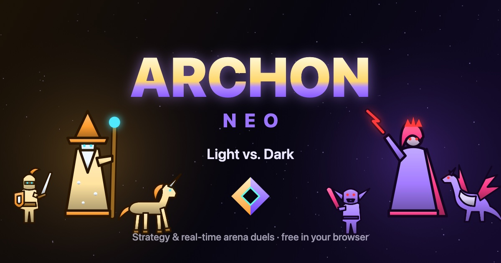

<div align="center">

# Archon NEO

**Light vs. Dark – a modern fan tribute to the 1983 classic.**
Turn-based strategy on a magic board meets real-time arena duels, right in your browser.

[](https://github.com/drhdev/archon-neo/actions/workflows/ci.yml)
[](LICENSE)




</div>

---

## Table of contents

- [About](#about)
- [The Legend](#the-legend)
- [Features](#features)
- [How to play](#how-to-play)
- [Quick start](#quick-start)
- [Deployment](#deployment)
- [Project structure](#project-structure)
- [Development](#development)
- [Roadmap](#roadmap)
- [Contributing](#contributing)
- [Disclaimer](#disclaimer)
- [License](#license)

## About

Archon NEO is a nostalgic, non-commercial re-imagining of *Archon: The Light and the Dark*, the 1983 strategy/action hybrid for the Commodore 64 and other home computers. It keeps the rules, units and spells of the original and gives them a contemporary look: smooth high-resolution vector figures modelled on the classic silhouettes, touch controls, sound synthesised on the fly and a layout made for phones.

It is a single static web app – plain HTML5 canvas, CSS and vanilla JavaScript modules. **No build step, no frameworks, no trackers, no external requests** (no Google Fonts, no CDNs). Everything the game needs ships in this repository.

## The Legend

> *Before the first dawn there was only the Balance – one world held between two forces.*
> *The **Light**, warm and steadfast. The **Darkness**, cold and cunning.*
> *Neither can exist without the other. Neither will ever rest.*

At the heart of this world lies the **Board of Power**: eighty-one squares of living stone, older than memory. Whoever commands its five **Power Points** becomes the **Archon** – and binds the other side for an age.

Now the age has turned. The **Wizard of Light** and the **Sorceress of Darkness** call their armies to the board, and the war for the Balance begins anew.

**The board breathes.** Light squares burn with the strength of the Light, dark squares feed the shadows – and between them lie the restless squares that follow the *cycle of light*, brightening as the sun rises and fading as night returns. Time is a weapon: strike while the cycle favours you and your champion enters battle with up to seven extra points of life. Strike at the wrong moment and even a dragon can fall. A wounded piece resting on a Power Point heals swiftly – and no spell can touch it.

**The armies.** The Light fights with reach and precision: steadfast **Knights**, patient **Archers**, spear-hurling **Valkyries**, boulder-throwing **Golems**, lightning-fast **Unicorns**, the storm spirit **Djinni** and the **Phoenix**, who bursts into flame and cannot be harmed while it burns. The Darkness answers with venom, terror and fire: swarming **Goblins**, spike-firing **Manticores**, the wailing **Banshee**, hulking **Trolls**, the **Basilisk** whose gaze is death, the mighty **Dragon** – and the **Shapeshifter**, who has no form of its own and becomes a perfect copy of whatever it fights.

**The arena.** When two enemies meet on the same square, the board falls away and the arena opens. No dice decide here – only reflexes, distance and nerve. Every champion strikes in eight directions only, every weapon has its own range and reload time, and ancient stone pillars rise from the floor and sink again, blocking bodies and missiles while they stand.

**The old magic.** Only the two masters command the seven spells – Teleport, Heal, Shift Time, Exchange, Summon Elemental, Revive and Imprison – and each can be woven only once per war. Should a master fall, their magic dies with them.

**Three paths lead to the Archon's throne:** seize all five Power Points at once, destroy every enemy piece, or leave the enemy nothing but imprisoned pieces.

*The board is set. The cycle turns. Which side will you fight for?*

The game tells this story itself: an illustrated seven-chapter intro with every unit's portrait, lore and stats opens on first launch and is always available under **The Legend** in the menu.

## Features

- **The Legend** – an illustrated, bilingual story intro that introduces the world, every unit, the arena, the magic and the paths to victory.
- **Faithful rules** – 9×9 board, 18 pieces per side in the original line-up, light/dark/cycling squares, 5 power points, original lifespans and attack strengths.
- **Real-time arena** – duels with 8-direction attacks, weapon ranges and reload times, stone pillars that fade in and out, plus the classic specials (invulnerable Phoenix blast, Banshee wail, Shapeshifter copying its foe). Painted in high resolution: flagstones in the colour of the contested square, an engraved compass of the eight directions, faceted pillars with shimmering runes.
- **Sound & music** – a SID-inspired synthesizer built on the Web Audio API: a distinct sound for every weapon, footsteps on the board, stereo panning, reverb and original background music for the title, the board and the arena. No audio files.
- **All 7 original spells** – Teleport, Heal, Shift Time, Exchange, Summon Elemental, Revive, Imprison.
- **Game modes** – single player against the AI in **three difficulty levels** (Easy, Normal, Hard) as Light or Darkness, and 2-player pass & play on one device.
- **Bilingual** – English and German, detected automatically and switchable in the menu.
- **Mobile first** – optimised for iPhone Safari and Android Chrome: no scrolling, rubber-banding or zoom, safe-area aware, full screen on Android, haptic feedback, screen kept awake while playing.
- **Install as app** – one tap in the menu installs Archon NEO on Android and desktop Chrome/Edge; on iPhone and iPad a short guide shows “Add to Home Screen”. Started from the home screen it runs full screen without browser bars and works offline, like a native app.
- **Installable & offline** – Progressive Web App with a service worker; plays without a connection after the first visit.
- **Resilient** – auto-save after every turn with "Continue game", validated save data, a watchdog that recovers stuck turns, an error boundary that keeps the render loop alive, automatic pause when the app goes to the background.
- **Accessible-minded** – full keyboard play on desktop (board cursor with arrows/WASD + Enter, E = spellbook; arena WASD/arrows + Space, 2nd player IJKL + Enter; Esc = pause), focus styles, `prefers-reduced-motion` support, ARIA labels.

## How to play

| | |
|---|---|
| **Goal** | Destroy all enemy pieces, occupy all 5 power points at once, or leave your opponent only imprisoned pieces. |
| **Board** | Tap a piece, then a target – or swipe it there. Ground units move straight, flyers move in any direction and over pieces, the Wizard and Sorceress teleport. |
| **Combat** | Moving onto an enemy starts a duel. Joystick bottom left, attack button bottom right. The square's colour grants up to +7 life to its side. |
| **Magic** | Select your spellcaster and tap **Spell**. Each spell works once per game; pieces on power points are immune. |
| **Two players** | During duels Light plays at the bottom, Darkness at the top with rotated controls. |

<details>
<summary><b>Units</b> (lifespan / attack strength / move)</summary>

| Light | Life | Str | Move | | Darkness | Life | Str | Move |
|---|---|---|---|---|---|---|---|---|
| Knight (sword) | 5 | 5 | 3 ground | | Goblin (club) | 5 | 5 | 3 ground |
| Archer (arrows) | 5 | 5 | 3 ground | | Manticore (tail spikes) | 8 | 4 | 3 ground |
| Valkyrie (magic spear) | 8 | 7 | 3 fly | | Banshee (wail) | 8 | 1 | 3 fly |
| Golem (boulder) | 15 | 10 | 3 ground | | Troll (boulder) | 14 | 10 | 3 ground |
| Unicorn (energy bolt) | 9 | 7 | 4 ground | | Basilisk (deadly gaze) | 6 | 9 | 3 ground |
| Djinni (whirlwind) | 15 | 6 | 4 fly | | Dragon (fire breath) | 17 | 11 | 4 fly |
| Phoenix (fire blast) | 12 | 2 | 5 fly | | Shapeshifter (copies foe) | 10 | – | 5 fly |
| Wizard (fireball) | 10 | 10 | 3 teleport | | Sorceress (lightning) | 10 | 8 | 3 teleport |

Summoned elementals: Air, Earth, Fire, Water.
</details>

## Quick start

Any static web server works – for example:

```bash
cd public && python3 -m http.server 8000
```

Open <http://localhost:8000>. To play on a phone in the same Wi-Fi, use your computer's LAN IP instead of `localhost`.

> The service worker (offline mode) only activates on `https://` or `localhost`, as required by browsers.

## Deployment

The repository is production-ready as a tiny container: **unprivileged nginx (non-root, port 8080)**, ~10 MB of runtime memory.

### Coolify

1. **New resource → Public/Private Repository →** select this repo.
2. Choose the **Docker Compose** build pack (it uses [`docker-compose.yml`](docker-compose.yml)).
3. Set your domain for the `archon` service (Coolify's `SERVICE_FQDN_ARCHON_8080` routes it to port 8080 and issues TLS).
4. Deploy. The health check (`/healthz`) tells Coolify when the container is ready.

The public URL is injected into the canonical link, Open Graph tags, `robots.txt` and `sitemap.xml` at container start. It is taken from `SITE_URL` or, on Coolify, detected automatically. Without a URL these absolute tags are removed rather than published with placeholders.

### Docker / Docker Compose

```bash
# Publish on http://localhost:8080
docker compose -f docker-compose.yml -f docker-compose.local.yml up -d --build

# or plain Docker
docker build -t archon-neo .
docker run -d -p 8080:8080 -e SITE_URL=https://archon.example.com \
  --cap-drop ALL --security-opt no-new-privileges:true archon-neo
```

| Variable | Default | Purpose |
|---|---|---|
| `SITE_URL` | – | Public base URL, e.g. `https://archon.example.com` (canonical, Open Graph, sitemap). |

### What the container takes care of

- **Security headers** – strict Content-Security-Policy (`'self'` only), `X-Content-Type-Options`, `X-Frame-Options`, `Referrer-Policy`, `Permissions-Policy`, COOP/CORP; nginx version hidden; dotfiles blocked.
- **Caching** – HTML/JS/CSS revalidate on every load (instant releases via ETag/304), images cached 30 days, service worker never cached.
- **Compression** – gzip for all text assets.
- **Operations** – `/healthz` endpoint, Docker `HEALTHCHECK`, restart policy, resource limits, log rotation, `no-new-privileges`, all capabilities dropped.
- **SEO** – descriptive title and meta description, canonical URL, Open Graph & Twitter cards with a 1200×630 preview image, JSON-LD `VideoGame` structured data, `robots.txt`, `sitemap.xml`, web app manifest, custom 404 page.

> TLS and HSTS are terminated by the reverse proxy (Coolify/Traefik), not inside the container.

## Project structure

```text
.
├── public/                  # Everything that is served
│   ├── index.html           # App shell, SEO metadata, overlays
│   ├── css/style.css
│   ├── js/
│   │   ├── game.js          # Rules, AI, arena, rendering, resilience
│   │   ├── art.js           # Vector unit artwork (rasterised & cached)
│   │   ├── arena-art.js     # Procedural arena floor and stone pillars
│   │   ├── audio.js         # Synthesised sound effects and music
│   │   ├── intro.js         # "The Legend" story intro
│   │   ├── i18n.js          # English / German strings
│   │   └── nomodule.js      # Message for very old browsers
│   ├── sw.js                # Service worker (offline)
│   ├── manifest.webmanifest
│   ├── icons/ · og-image.jpg · robots.txt · sitemap.xml · 404.html
├── nginx/                   # nginx site config + security headers
├── docker/40-site-url.sh    # Injects SITE_URL at container start
├── scripts/
│   ├── check.mjs            # i18n, version and file-reference checks
│   ├── smoke-test.sh        # Runs the image and verifies it end-to-end
│   └── render-assets.sh     # Regenerates icons & preview image
├── tools/assets.html        # Canvas renderer for the PNG assets
├── Dockerfile · docker-compose.yml · docker-compose.local.yml
└── .github/workflows/ci.yml
```

## Development

There is nothing to install. Edit the files in `public/` and reload.

```bash
node scripts/check.mjs                           # consistency checks (also run in CI)
docker build -t archon-neo . && sh scripts/smoke-test.sh archon-neo   # container smoke test
sh scripts/render-assets.sh                      # regenerate icons / preview (needs Chrome)
```

**Releasing:** bump `APP_VERSION` in `public/js/game.js` and `VERSION` in `public/sw.js` (the checks enforce that they match), add a [CHANGELOG](CHANGELOG.md) entry and tag the commit.

**Adding a language:** add a block to `STRINGS` in `public/js/i18n.js` and its code to `LANGS`; `scripts/check.mjs` reports any missing keys.

## Roadmap

- [x] Faithful single-device game: AI (3 levels) and pass & play
- [x] English & German, offline PWA, Docker/Coolify deployment
- [ ] **Live online battles** – two players on two devices in real time
- [ ] **Hall of Fame & leaderboard**
- [ ] **Lobby** – see and challenge human players who are ready to play
- [ ] More languages

Ideas and feedback are welcome in the [issues](https://github.com/drhdev/archon-neo/issues).

## Contributing

Contributions are welcome! Please open an issue first for larger changes. Keep the project dependency-free, run `node scripts/check.mjs` before opening a pull request and describe how you tested on mobile.

## Disclaimer

Archon NEO is a **non-commercial nostalgia project** made by fans, for fans. It is a homage to *Archon: The Light and the Dark*, created in 1983 by Free Fall Associates (Jon Freeman, Anne Westfall and Paul Reiche III) and published by Electronic Arts.

There is **no intention to infringe any copyright, trademark or other rights**. "Archon" and related names are the property of their respective owners; this project is not affiliated with, endorsed by or sponsored by them. All code and artwork in this repository were created from scratch – no original game assets are used. If you are a rights holder and have concerns, please [open an issue](https://github.com/drhdev/archon-neo/issues) and we will respond promptly.

## License

Source code and artwork in this repository are released under the [GNU General Public License v3.0](LICENSE).
